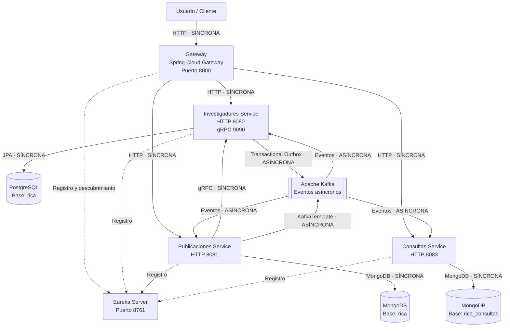

# Arquitectura de RICA

## 1. Contexto y motivadores

RICA es un sistema orientado a la gestión de investigadores y sus publicaciones académicas. Permite registrar, consultar y administrar investigadores, asociar publicaciones a cada investigador y consultar información consolidada. Está construido mediante microservicios que se comunican mediante HTTP, gRPC y eventos Kafka. La arquitectura incorpora descubrimiento de servicios con Eureka y un modelo de lectura independiente mediante CQRS.

### Atributos de calidad prioritarios

Los siguientes atributos están ordenados según las necesidades que refleja el diseño actual. Los escenarios son objetivos propuestos para validar la arquitectura, no mediciones ya realizadas.

1. **Integridad de los datos:** cuando se registra un investigador, su información y el evento correspondiente deben persistirse de forma atómica en PostgreSQL, evitando que se guarde el investigador sin registrar el evento que debe notificarse.
2. **Disponibilidad y resiliencia:** si `investigadores-service` deja de responder, `publicaciones-service` debe detectar la indisponibilidad mediante el Circuit Breaker y evitar mantener llamadas bloqueadas indefinidamente.
3. **Rendimiento de consultas:** cuando un usuario consulta la ficha de un investigador, `consultas-service` debe responder utilizando su propio modelo de lectura, sin tener que consultar en tiempo real los demás microservicios.
4. **Modificabilidad:** los cambios en la lógica de negocio de un servicio deben poder realizarse sin modificar directamente el código interno de los demás servicios.
5. **Desacoplamiento:** cuando se registra o elimina un investigador, los demás servicios deben recibir la notificación mediante eventos, sin necesitar una llamada síncrona entre todos los participantes.

### Restricciones del proyecto

- El proyecto utiliza Java 25, Spring Boot y Spring Cloud.
- La arquitectura está dividida en cinco componentes principales: Eureka Server, Gateway, Investigadores, Publicaciones y Consultas.
- Se utilizan PostgreSQL y MongoDB como sistemas de almacenamiento.
- Kafka se utiliza para la comunicación asíncrona.
- El proyecto se ejecuta en un entorno de desarrollo con Docker y servicios configurados mediante archivos YAML y Docker Compose.
- No se encontraron manifiestos de Kubernetes en la copia revisada.
- La arquitectura está desarrollada en el contexto de un proyecto académico, por lo que se busca mantener una infraestructura que pueda administrarse sin herramientas de operación excesivamente complejas.

---

## 2. Estilos y patrones por componente

| Componente | Estilo / patrón | Almacén de datos | Comunicación | Atributo que sirve |
|---|---|---|---|---|
| `gateway` | API Gateway | No posee base de datos propia | HTTP entrante y enrutamiento HTTP hacia los servicios mediante Eureka | Simplifica el acceso de los clientes y centraliza el enrutamiento. |
| `eureka-server` | Service Discovery | Registro de servicios en memoria | Comunicación de registro y descubrimiento con los clientes Eureka | Facilita la localización de servicios y reduce el acoplamiento a direcciones fijas en el enrutamiento HTTP. |
| `investigadores-service` | Microservicio + arquitectura hexagonal | PostgreSQL (`rica`) | HTTP, servidor gRPC y publicación/consumo de eventos Kafka | Integridad de datos y testabilidad del dominio. |
| `publicaciones-service` | Microservicio con separación por capas y adaptadores | MongoDB (`rica`) | HTTP, cliente gRPC y Kafka | Flexibilidad del esquema de publicaciones y resiliencia ante fallos del servicio de investigadores. |
| `consultas-service` | CQRS, lado de lectura | MongoDB (`rica_consultas`) | HTTP y consumo de eventos Kafka | Rendimiento de consultas e independencia del modelo de lectura. |
| Kafka | Event-Driven Architecture (EDA) | Log de eventos administrado por Kafka | Publicación y suscripción asíncrona | Desacoplamiento y propagación de cambios entre servicios. |
| Eliminación de investigador | Saga coreografiada | Datos distribuidos en PostgreSQL y MongoDB | Eventos Kafka | Consistencia eventual entre servicios sin una transacción distribuida. |

### Justificación de los estilos y patrones

**API Gateway:** el componente `gateway` recibe las solicitudes HTTP de los clientes y las dirige hacia los servicios correspondientes. Utiliza rutas con `lb://` para localizar los servicios registrados en Eureka. Esto evita que el cliente tenga que conocer las direcciones internas de cada microservicio.

**Arquitectura hexagonal en Investigadores:** el código separa el dominio, la aplicación y la infraestructura. La lógica de negocio se encuentra en el dominio y los casos de uso se implementan en la capa de aplicación. Los adaptadores de entrada y salida permiten conectar HTTP, gRPC, PostgreSQL y Kafka sin mezclar esas tecnologías con las reglas del dominio.

**Microservicio de Publicaciones:** mantiene su propia lógica de negocio y almacenamiento. La comunicación con Investigadores se realiza mediante gRPC para verificar la existencia de un investigador antes de registrar una publicación. También utiliza Kafka para reaccionar a eventos y notificar cambios.

**CQRS en Consultas:** `consultas-service` mantiene una base MongoDB independiente llamada `rica_consultas`. Su modelo de lectura se actualiza a partir de eventos publicados por los servicios de escritura. De esta manera, las consultas no necesitan realizar solicitudes síncronas a los servicios que mantienen los datos originales.

**EDA mediante Kafka:** los servicios publican eventos cuando ocurre un cambio importante en el negocio. Los consumidores reaccionan a estos eventos de manera independiente, reduciendo la necesidad de comunicación directa entre los servicios.

**Saga coreografiada:** la eliminación de un investigador involucra a Investigadores y Publicaciones. Cada servicio realiza su parte y comunica el resultado mediante eventos. No existe un orquestador central que controle todos los pasos.

### Eventos y fronteras de integración

| Evento / tópico | Productor | Consumidor(es) | Información principal |
|---|---|---|---|
| `investigadores.registrados` | Investigadores | Publicaciones y Consultas | Identificador, correo institucional y nombre del investigador. |
| `publicaciones.registradas` | Publicaciones | Consultas | Identificador de publicación, correo del investigador, título, tipo y año. |
| `investigadores.en-eliminacion` | Investigadores | Publicaciones y Consultas | Correo institucional del investigador. |
| `publicaciones.marcadas-huerfanas` | Publicaciones | Investigadores | Correo institucional, cantidad de publicaciones marcadas y correlationId. |
| `investigadores.eliminados` | Investigadores | Consultas | Correo institucional del investigador eliminado. |

Los eventos relacionados con el registro y la eliminación del investigador se guardan primero en la tabla Outbox de PostgreSQL. Un proceso programado se encarga de publicarlos en Kafka.

En cambio, `publicaciones-service` utiliza `KafkaTemplate` para publicar directamente el evento `publicaciones.registradas` y la confirmación `publicaciones.marcadas-huerfanas`. Por lo tanto, el patrón Transactional Outbox no está implementado de forma uniforme en todos los servicios.

---

## 3. Diagrama de contenedores (C4)

El siguiente diagrama representa los componentes principales, sus almacenes de datos y los mecanismos de comunicación identificados en el código.

### Explicación de las conexiones

- **Usuario → Gateway:** el cliente realiza solicitudes HTTP al punto de entrada de la aplicación.
- **Gateway → Microservicios:** el Gateway dirige las solicitudes HTTP según las rutas configuradas y utiliza Eureka para descubrir los servicios.
- **Microservicios → Eureka:** los servicios se registran para que puedan ser localizados por los componentes que necesitan comunicarse con ellos.
- **Publicaciones → Investigadores:** se utiliza gRPC para comprobar si un investigador existe antes de registrar una publicación. Esta comunicación es síncrona.
- **Investigadores → PostgreSQL:** almacena los investigadores y los registros de Outbox.
- **Publicaciones → MongoDB:** almacena las publicaciones.
- **Consultas → MongoDB:** almacena el modelo de lectura independiente.
- **Servicios → Kafka:** los productores publican eventos y los consumidores reaccionan a ellos de manera asíncrona.

**Nota:** las conexiones punteadas hacia Eureka representan registro y descubrimiento de servicios, no solicitudes de negocio. Kafka se representa como un intermediario común de eventos; los productores y consumidores concretos están detallados en la tabla anterior.

---

## 4. Decisiones (ADR)

### ADR-001: Separación del sistema en microservicios y almacenamiento independiente

- **Estado:** Aceptada.

#### Contexto

RICA necesita administrar investigadores, publicaciones y consultas. Estas responsabilidades tienen necesidades diferentes de almacenamiento y procesamiento. Mantener todas las funcionalidades en un único componente dificultaría su evolución independiente y mezclaría las responsabilidades de cada dominio.

#### Decisión

Dividir el sistema en microservicios independientes:

- `investigadores-service`: administra los investigadores y utiliza PostgreSQL.
- `publicaciones-service`: administra las publicaciones y utiliza MongoDB.
- `consultas-service`: mantiene el modelo de lectura en otra base MongoDB.
- `gateway`: centraliza el acceso HTTP.
- `eureka-server`: proporciona descubrimiento de servicios.

Cada servicio administra sus propios datos y expone mecanismos de comunicación para los demás componentes.

#### Alternativa descartada

Un monolito modular con una única aplicación y una base de datos compartida. Aunque habría simplificado la comunicación y el despliegue, habría limitado la independencia de los componentes y mezclado las responsabilidades de almacenamiento.

#### Consecuencias

**Positivas:**
- Separación de responsabilidades.
- Posibilidad de modificar y probar los servicios de manera independiente.
- Cada servicio puede utilizar el almacenamiento más adecuado para sus necesidades.
- Facilita la evolución de los componentes sin modificar toda la aplicación.

**Negativas:**
- Aumenta la complejidad de despliegue y configuración.
- Se necesita administrar la comunicación entre servicios.
- Aparecen problemas de consistencia distribuida.
- Se requieren herramientas adicionales para monitorear y diagnosticar errores.

### ADR-002: Comunicación síncrona mediante gRPC para verificar investigadores

- **Estado:** Aceptada.

#### Contexto

Al registrar una publicación, el sistema necesita comprobar que el investigador asociado exista. Esta validación requiere una respuesta inmediata para decidir si se permite continuar con el registro.

La comunicación mediante eventos no sería adecuada para esta validación, porque la operación necesita conocer el resultado antes de continuar.

#### Decisión

Implementar un servidor gRPC en `investigadores-service`, en el puerto 9090, con el método `ExisteInvestigador`.

`publicaciones-service` utiliza un cliente gRPC para enviar el correo institucional y recibir una respuesta booleana que indica si el investigador existe.

La comunicación está protegida mediante un Circuit Breaker de Resilience4j con los siguientes parámetros identificados en el código:

- Ventana deslizante de 10 llamadas.
- Mínimo de 5 llamadas antes de evaluar la tasa de fallos.
- Umbral de fallos del 50 %.
- Tiempo de espera en estado abierto de 10 segundos.
- Plazo máximo de 5 segundos para la llamada gRPC.

#### Alternativa descartada

Utilizar una solicitud HTTP REST para consultar la existencia del investigador. Se descartó en favor de gRPC como mecanismo de comunicación entre estos dos servicios.

#### Consecuencias

**Positivas:**
- Comunicación eficiente entre servicios.
- Contrato definido mediante Protocol Buffers.
- Respuesta inmediata para validar la existencia del investigador.
- El Circuit Breaker evita continuar realizando llamadas cuando el servicio presenta fallos.

**Negativas:**
- Existe dependencia síncrona entre Publicaciones e Investigadores.
- Si Investigadores no está disponible, el registro de publicaciones puede verse afectado.
- Se necesita mantener los contratos `.proto` y generar las clases correspondientes.
- La configuración actual del cliente utiliza `static://localhost:9090`, lo que requiere ajustes para entornos donde los servicios se ejecuten en contenedores separados.

### ADR-003: Arquitectura orientada a eventos, Transactional Outbox, CQRS y Saga

- **Estado:** Aceptada.

#### Contexto

Los cambios realizados en Investigadores y Publicaciones deben propagarse hacia otros componentes sin establecer una cadena de llamadas síncronas entre todos ellos.

Además, el sistema necesita mantener un modelo de lectura independiente y coordinar la eliminación de un investigador junto con sus publicaciones.

Publicar un evento directamente después de guardar un dato puede provocar una inconsistencia si la operación de base de datos termina correctamente, pero Kafka no recibe el evento.

#### Decisión

Utilizar Kafka como mecanismo de comunicación asíncrona y combinar los siguientes patrones:

1. **Transactional Outbox:** `investigadores-service` guarda los eventos en una tabla Outbox dentro de la misma transacción que la operación de negocio. Un proceso programado publica los eventos pendientes en Kafka.
2. **CQRS:** `consultas-service` mantiene un modelo de lectura independiente en MongoDB, actualizado mediante los eventos recibidos.
3. **Saga coreografiada:** la eliminación de un investigador se coordina mediante eventos entre Investigadores y Publicaciones.

El flujo de eliminación es el siguiente:

1. Investigadores marca al investigador como pendiente de eliminación y publica `investigadores.en-eliminacion`.
2. Publicaciones consume el evento y marca las publicaciones asociadas como huérfanas.
3. Publicaciones publica `publicaciones.marcadas-huerfanas`.
4. Investigadores recibe la confirmación, elimina al investigador y publica `investigadores.eliminados`.
5. Consultas consume los eventos y actualiza su modelo de lectura.

#### Alternativa descartada

Utilizar únicamente llamadas HTTP o gRPC entre los servicios para propagar todos los cambios y coordinar la eliminación.

También se descarta, para el alcance actual, implementar una Saga orquestada mediante un componente central que controle cada paso.

#### Consecuencias

**Positivas:**
- Menor acoplamiento entre los servicios.
- Los cambios se propagan sin requerir respuestas inmediatas.
- El modelo de lectura puede optimizarse para las consultas.
- El Outbox reduce el riesgo de perder eventos por fallos entre la escritura en PostgreSQL y la publicación en Kafka.
- La Saga permite coordinar una operación distribuida sin una transacción global.

**Negativas:**
- Los datos pueden tardar en sincronizarse entre servicios.
- Los consumidores deben tolerar eventos duplicados y procesarlos de forma idempotente.
- La depuración de errores requiere rastrear eventos y procesos en diferentes servicios.
- El proceso Outbox necesita mantenimiento y supervisión.
- Publicaciones no utiliza Outbox para todos sus eventos, por lo que todavía existe riesgo de escritura dual en esa parte del sistema.
- La Saga puede quedar incompleta si un consumidor falla y no se recupera correctamente.

---

## 5. Fitness functions

Las siguientes fitness functions permiten comprobar que la arquitectura conserve sus características principales. Se distinguen las verificaciones que ya tienen soporte en el proyecto de las reglas que se propone incorporar.

### Fitness function 1: Integridad de la arquitectura hexagonal

- **Regla:** el dominio de `investigadores-service` no debe depender directamente de clases de infraestructura, controladores, repositorios JPA o herramientas externas.
- **Mecanismo de verificación:** revisar las dependencias entre paquetes mediante pruebas de arquitectura con ArchUnit o una herramienta equivalente.
- **Criterio de aceptación:** ninguna dependencia no permitida desde el dominio hacia infraestructura.
- **Ejecución:** durante la integración continua (CI), en cada push o pull request.
- **Estado:** regla propuesta; debe incorporarse una prueba específica de arquitectura.

### Fitness function 2: Pruebas automatizadas de los microservicios

- **Regla:** los cambios realizados en los servicios no deben romper las pruebas automatizadas.
- **Mecanismo de verificación:** ejecutar `mvnw test` en cada servicio mediante el workflow de GitHub Actions.
- **Criterio de aceptación:** todos los trabajos de pruebas deben finalizar correctamente.
- **Ejecución:** en cada push y pull request.
- **Estado:** existe un workflow de CI configurado para ejecutar pruebas Maven en los cinco componentes. La cobertura de integración debe seguir ampliándose.

### Fitness function 3: Separación de los almacenes de datos

- **Regla:** ningún microservicio debe acceder directamente a la base de datos interna de otro servicio.
- **Mecanismo de verificación:** revisar las configuraciones de conexión y las dependencias de persistencia de cada servicio.
- **Criterio de aceptación:** Investigadores administra PostgreSQL, Publicaciones administra su base MongoDB y Consultas administra `rica_consultas`.
- **Ejecución:** revisión de código y validación durante cada cambio de configuración.
- **Estado:** las configuraciones revisadas mantienen bases diferenciadas.

---

## 6. Mesh: ¿lo necesitamos?

### Service mesh: NO

RICA cuenta con cinco componentes principales, pero no todos son microservicios de negocio. Actualmente, la comunicación entre ellos se administra mediante Spring Cloud Gateway, Eureka, gRPC y Kafka.

No se identificó una infraestructura basada en Kubernetes ni una necesidad de administrar políticas complejas de tráfico entre una gran cantidad de servicios.

Implementar un service mesh agregaría complejidad de infraestructura, configuración y mantenimiento que no se justifica por el tamaño actual del proyecto.

**Alternativa utilizada:** Spring Cloud Gateway para el enrutamiento HTTP, Eureka para descubrimiento de servicios, Resilience4j para resiliencia y Kafka para comunicación asíncrona.

### Data mesh: NO

Aunque RICA utiliza dos tecnologías de almacenamiento y mantiene bases independientes para sus servicios, esto no significa que necesite implementar Data Mesh.

El proyecto tiene tres áreas principales de datos: investigadores, publicaciones y consultas. Sin embargo, no se evidencia una estructura de múltiples equipos autónomos responsables de publicar y administrar productos de datos independientes.

La separación actual responde a la autonomía de los microservicios y al patrón CQRS, no a una estrategia organizacional de Data Mesh.

**Alternativa utilizada:** cada microservicio administra sus propios datos y `consultas-service` mantiene un modelo de lectura separado que se alimenta mediante eventos Kafka.

---

## 7. Riesgos y deuda conocida

| Riesgo / deuda | Consecuencia | Acción propuesta |
|---|---|---|
| Dependencia de Eureka | Si Eureka deja de funcionar, pueden presentarse problemas para descubrir servicios y resolver rutas dinámicas. | Supervisar su disponibilidad y evaluar mecanismos de recuperación y tolerancia ante fallos. |
| Dirección gRPC estática | El cliente de Publicaciones utiliza `localhost:9090`; esto puede fallar cuando los servicios se ejecuten en contenedores diferentes. | Configurar la dirección del servicio mediante variables de entorno y utilizar nombres de servicio dentro de la red Docker. |
| Consistencia eventual de CQRS | El modelo de lectura puede presentar información desactualizada mientras se procesan los eventos. | Monitorear el retraso de consumidores y permitir mecanismos de reproyección o reconstrucción del modelo de lectura. |
| Publicación directa de eventos en Publicaciones | Un fallo entre la persistencia de una publicación y el envío a Kafka puede dejar información sin propagar. | Evaluar la incorporación de Transactional Outbox en `publicaciones-service`. |
| Eventos duplicados | Los consumidores pueden procesar más de una vez un mismo evento, generando inconsistencias si no son idempotentes. | Mantener registros de eventos procesados y validar la idempotencia de cada consumidor. |
| Fallos durante la Saga | La eliminación de un investigador puede quedar pendiente si Publicaciones no procesa o no confirma el evento. | Implementar supervisión de operaciones pendientes, reintentos controlados y mecanismos de recuperación. |
| Infraestructura distribuida | La ejecución local requiere coordinar varios servicios, bases de datos y Kafka. | Mantener configuraciones Docker claras, verificar dependencias y documentar los comandos de ejecución. |

### Revisión cruzada

**Grupo revisor:** [Pendiente de completar].

**Observaciones recibidas:**
- [Registrar aquí los comentarios realizados por el grupo revisor].
- [Indicar los problemas identificados en la tabla de estilos, el diagrama, los ADR o las fitness functions].

**Correcciones incorporadas:**
- [Describir los cambios realizados a partir de la revisión].
- [Indicar qué observaciones no se incorporaron y justificar la decisión, si corresponde].

La revisión cruzada debe completarse con los comentarios reales de otro grupo antes de entregar la versión definitiva del documento.
